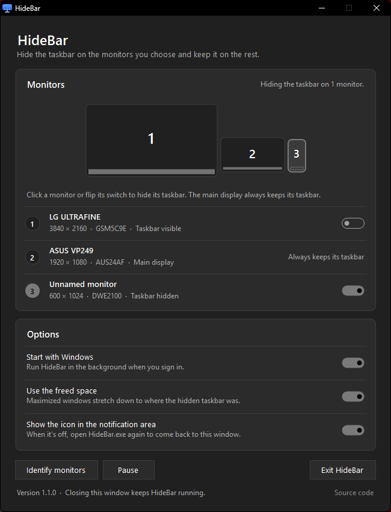

# HideBar

Hide the Windows taskbar on the monitors you choose and keep it on the rest.



Windows only lets you show the taskbar on every monitor or on the main one. HideBar covers the case in between: pick a secondary monitor and that monitor's taskbar goes away, while your other monitors keep theirs. It started as a fix for a small 7" screen mounted inside a PC case, where a taskbar only gets in the way.

## Features

- A window that draws your monitors the way they sit on your desk. Click one, or flip its switch, to hide its taskbar.
- Maximized windows get the full height of the screen, because the space the taskbar reserved is given back.
- The taskbar stays hidden when Explorer restarts, a monitor is reconnected or the display layout changes.
- **Identify monitors** shows each monitor's number on the monitor itself.
- Follows the Windows light or dark mode and your accent color.
- Can start with Windows, and can run without a tray icon.
- Pausing or exiting brings everything back to normal.
- A single small `.exe` with no installer and no dependencies beyond what Windows already ships.

## Requirements

Windows 10 (version 1607 or later) or Windows 11. HideBar runs on .NET Framework 4.x, which is part of Windows.

## Download

Get [`HideBar.exe`](https://github.com/Orloxx23/hide-windonws-taskbar/releases/latest/download/HideBar.exe) from the [latest release](https://github.com/Orloxx23/hide-windonws-taskbar/releases/latest) and run it. There is nothing to install.

The exe isn't code-signed, so Windows SmartScreen may warn you the first time you run it. Click **More info**, then **Run anyway**, or build it yourself as shown below.

## Usage

1. Run `HideBar.exe`. Its window opens.
2. Click the monitor whose taskbar you want to hide, or flip its switch.
3. Close the window. HideBar keeps running in the notification area; click its icon, or open `HideBar.exe` again, to come back.

| Option | What it does |
|---|---|
| Start with Windows | Runs HideBar in the background when you sign in, without opening the window. |
| Use the freed space | Lets maximized windows stretch down to where the hidden taskbar was. |
| Show the icon in the notification area | When it's off, HideBar has no visible trace; open `HideBar.exe` again to get the window back. |

| Command | What it does |
|---|---|
| `HideBar.exe` | Starts HideBar, or opens its window if it's already running. |
| `HideBar.exe --exit` | Closes HideBar and shows every taskbar again. |
| `HideBar.exe --startup` | Starts without opening the window. **Start with Windows** uses it. |

Settings are saved in `%APPDATA%\HideBar\settings.ini`. The `monitors.txt` file from version 1.0 is moved over automatically.

## Build from source

No Visual Studio needed. The scripts use the C# compiler that comes with .NET Framework:

```bat
git clone https://github.com/Orloxx23/hide-windonws-taskbar.git
cd hide-windonws-taskbar
build.cmd
test.cmd
```

`build.cmd` creates `HideBar.exe` and `test.cmd` runs the tests. To redraw the icon, run `powershell -ExecutionPolicy Bypass -File tools\make-icon.ps1`.

## Project layout

```
src/
  Program.cs        entry point and command line
  HideBarApp.cs     builds the app from its parts
  Core/             what to hide and when; no Windows or UI code
  Platform/         Win32 calls, the settings file, the Run key, messages between instances
  UI/               the window, the tray icon and the theme
    Controls/       reusable controls: card, switch, number badge, monitor layout
tests/              tests for Core, run against an in-memory fake of Windows
tools/              the script that draws assets/HideBar.ico
```

`Core` reaches Windows only through the interfaces in [`src/Core/Ports.cs`](src/Core/Ports.cs), so `TaskbarController`, which holds all the hiding logic, runs against fakes in the tests.

## How it works

Each secondary taskbar in Windows 10 and 11 is an Explorer window of class `Shell_SecondaryTrayWnd`. HideBar finds the one on each chosen monitor, hides it with `ShowWindow`, and sets that monitor's work area to its full bounds with `SystemParametersInfo(SPI_SETWORKAREA)`.

The work area is changed without broadcasting `WM_SETTINGCHANGE`. That broadcast makes Explorer lay out its taskbars again, which shows the hidden one. A timer checks every second, and again on every display change, and hides the taskbar if Explorer brought it back.

Monitors are matched by the model ID in their EDID (for example `DWE2100`), so the choice survives plugging the monitor into another port or reordering your displays.

## Limitations

- Only secondary taskbars can be hidden, not the one on the main display.
- Windows that were already maximized on the monitor keep their old size until you maximize them again. This follows from not broadcasting the work area change.
- Two monitors of the same model share a model ID, so picking one picks both.
- The window is drawn for the main display's scaling. On a monitor with different scaling, Windows stretches it and it may look slightly soft.

## License

[MIT](LICENSE)
